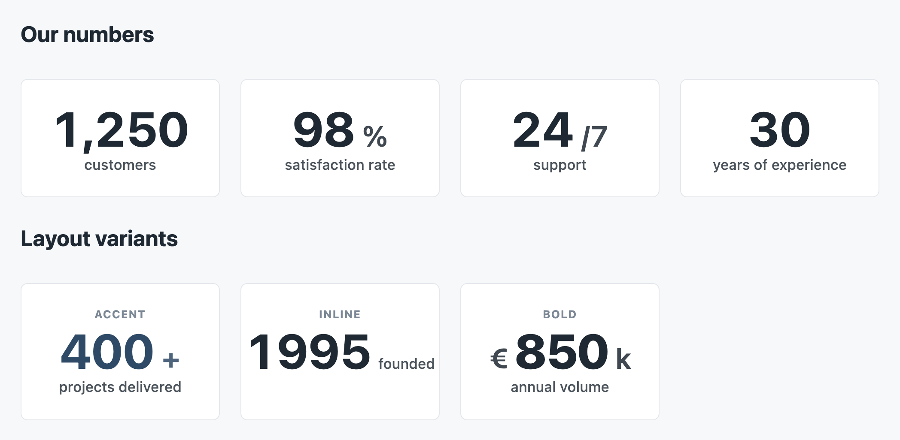
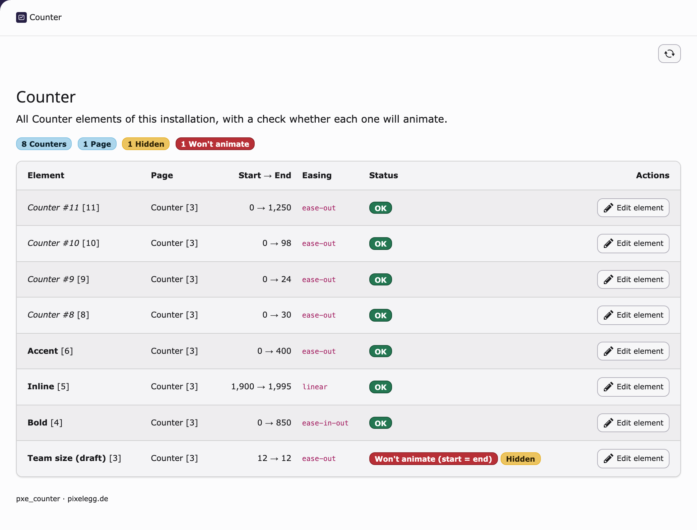

# Counter (animated number) – TYPO3 extension `pxe_counter`

[](https://github.com/pixelegg/pxe-counter/actions/workflows/ci.yml)
[](https://get.typo3.org/)
[](LICENSE.txt)

A content element that shows a number counting up from a start to an end value when it
scrolls into view ("1,200 happy clients", "98 %", "€ 4.5 M"). The final value is rendered
server-side and formatted for the site language, so it is correct without JavaScript and for
screen readers; a small dependency-free script (3 KB, no jQuery) adds the animation. CSS and JS
are loaded only on pages that use the element. A backend module *Web > Counter* lists every
counter of the installation and flags those that will not animate.

## Screenshots

| Content element in the frontend | Editing form | Backend module |
| --- | --- | --- |
|  |  |  |

*(Screenshots are placeholders until the first release.)*

## Requirements

| | |
| --- | --- |
| TYPO3 | 13.4 LTS or 14 |
| PHP | 8.2, 8.3 or 8.4 with `ext-intl` (required by TYPO3 anyway) |
| Core extension | `fluid_styled_content` (the element renders through `lib.contentElement`) |

## Installation

```bash
composer require pixelegg/pxe-counter
```

Then activate the TypoScript in **one** of two ways (not both):

**A. Site set (sites configured entirely through sets)**
*Site Management > Sites > your site > Sets*: add **Counter (animated number)**
(`pixelegg/counter`). Settings become editable under *Site Management > Settings*.
Note: TYPO3 13/14 only load the TypoScript of site sets when the root page has
**no** `sys_template` record. If your site still has a root template, use B.

**B. Static template**
*Web > Template > your root template > Includes*: add **Counter (animated number)**.
Settings are TypoScript constants (see below).

Both load the same `Configuration/TypoScript/setup.typoscript`. Clear the caches afterwards.
Non-composer installations install the extension from the TER and continue with step A or B.

## Usage

Add the content element **Counter (animated number)** (*Zähler (animierte Zahl)* in German).
It appears in the *Default* tab of the new-content wizard (TYPO3 13: *Common*). Fields:

| Field | Meaning | Default |
| --- | --- | --- |
| Start value | Number the animation starts from | 0 |
| End value | Number that is finally shown (also without JavaScript) | 0 |
| Prefix | Short text before the number, e.g. `€` or `+` | – |
| Suffix | Short text after the number, e.g. `%` or `k` | – |
| Caption | Text below the number | – |
| Decimal places | 0–4 | 0 |
| Group thousands | Thousands separator according to the site language (`1,000` / `1.000` / `1 000`) | on |
| Duration | Animation length in seconds | 2 |
| Delay | Pause before the animation starts, in seconds | 0 |
| Easing | ease-out (fast → slow), linear, ease-in-out | ease-out |
| Layout | Default, Accent (primary colour), Inline (number and caption side by side), Bold | Default |

The header, frame class and spacing from the *Appearance* tab apply like for any other
content element.

### Number formatting

Grouping and decimal separators follow the **locale of the site language** (`de_DE` → `1.234,5`,
`en_US` → `1,234.5`, `fr_FR` → `1 234,5`), both server-side (`NumberFormatter`) and during
the animation (`Intl.NumberFormat`). Nothing is hard-coded.

## TypoScript constants / site settings

| Constant | Default | Purpose |
| --- | --- | --- |
| `plugin.tx_pxecounter.settings.includeAssetsGlobally` | `0` | `0`: CSS/JS are added only on pages with a counter (`<f:asset.css>` / `<f:asset.script>`, deferred). `1`: the files are registered through `page.includeCSS` / `page.includeJSFooter` on every page. Use `1` with themes that concatenate or compress those lists (e.g. t3sbootstrap), where AssetCollector assets would bypass the bundle. |
| `plugin.tx_pxecounter.view.templateRootPath` | `EXT:pxe_counter/Resources/Private/Templates/ContentElements/` | Template directory (index 10) |
| `plugin.tx_pxecounter.view.partialRootPath` | `EXT:pxe_counter/Resources/Private/Partials/ContentElements/` | Partial directory (index 10) |
| `plugin.tx_pxecounter.view.layoutRootPath` | `EXT:pxe_counter/Resources/Private/Layouts/ContentElements/` | Layout directory (index 10) |

With the site set the same keys appear in *Site Management > Settings*, category
*Counter (animated number)*.

## Overriding the template

Keep index 10 for the extension and add your own directory at index 20:

```typoscript
tt_content.pxe_counter {
    templateRootPaths.20 = EXT:my_sitepackage/Resources/Private/Templates/ContentElements/
}
```

Copy `Resources/Private/Templates/ContentElements/Counter.html` there and adjust it. The template
receives:

- `{counter}` from `Pixelegg\PxeCounter\DataProcessing\CounterProcessor`: `from`, `to`,
  `fromFormatted`, `toFormatted`, `decimals`, `grouping`, `duration`, `delay`, `easing`,
  `layout`, `prefix`, `suffix`, `label`, `locale` (BCP 47 tag), `animate`
- `{flexform}` with the raw FlexForm values
- `{data}` with the `tt_content` row, `{settings}` with the TypoScript settings

Keep the `pxe-counter`, `pxe-counter__number` and `pxe-counter__value` classes and the `data-*`
attributes: `counter.js` relies on them. Layout variants are plain class hooks
(`layout-default`, `layout-1`, `layout-2`, `layout-3`) on the element, styled in
`Resources/Public/Css/counter.css`; override the CSS in your theme or replace the file via your
own template.

## Accessibility and behaviour without JavaScript

- The HTML always contains the final, formatted number. Without JavaScript the number is
  simply shown.
- While counting, the script hides the changing digits from assistive technology
  (`aria-hidden`) and offers a visually hidden copy of the final value instead. No
  `aria-live` region, so nothing is announced per frame. When the animation ends the original
  markup is restored.
- `prefers-reduced-motion: reduce` disables the animation; the final value is shown directly.
- The animated value keeps the width of the final number, so surrounding content does not
  shift while counting.
- Colours and fonts inherit from the site; the "Accent" layout uses `--bs-primary` with a
  fallback.

## Backend module

*Web > Counter* lists all Counter elements of the installation (also hidden ones and
translations) with page, start → end, easing and a status: **OK**, or **Won't animate** when the
start equals the end. Each row links to the element and to its page. Available to every backend
user with access to the module; English and German.

If the optional dashboard extension `pxe_hub` is installed, the module is hidden from the
module menu and reached through the hub instead. Nothing else changes.

## Development

```bash
composer install
composer ci:cs              # php-cs-fixer (typo3/coding-standards), dry run
composer ci:stan            # PHPStan level 8
composer ci:rector          # rector, dry run
composer ci:test            # unit tests
composer ci:test:functional # functional tests (sqlite)
```

CI runs the suite for TYPO3 13.4 (PHP 8.2–8.4) and TYPO3 14 (PHP 8.3–8.4); see
`.github/workflows/ci.yml`. Tags `vX.Y.Z` are published to the TER by
`.github/workflows/publish-ter.yml` when the repository secret `TYPO3_API_TOKEN` is set.

## Changelog

See [CHANGELOG.md](CHANGELOG.md).

## License

GPL-2.0-or-later, see [LICENSE.txt](LICENSE.txt). Made by [pixelegg](https://www.pixelegg.de).
